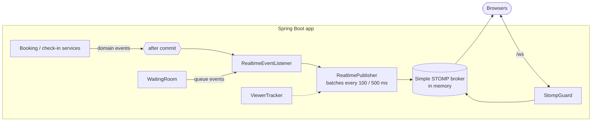

# FestPass architecture

FestPass is one Spring Boot application (a modular monolith) backed by PostgreSQL. The React app is built into the same JAR. This document grows phase by phase; Phase 7 adds the component and sequence diagrams and an explanation of each guarantee.

## Real-time layer (Phase 3)

- **Changes are announced only after the database commits.** Services publish Spring application events (`SeatsChanged`, `AvailabilityChanged`, `HoldEnded`, `CheckinRecorded`) inside their transaction. `RealtimeEventListener` receives them with `@TransactionalEventListener`, which runs only after a successful commit, so a rolled-back hold is never shown to anyone.
- **Batching.** `RealtimePublisher` collects seat changes per event and sends them at most every 100 ms; a seat that changed twice in that window is sent once, with its latest status. Stats and queue counters go out at most every 500 ms, and only for events someone is watching.
- **Security.** `StompGuard` rejects every client `SEND` and only allows subscriptions to known destinations (some by role). The handshake is an ordinary HTTP request through Spring Security, so the session cookie identifies the user.
- **Viewers.** `ViewerTracker` counts WebSocket connections subscribed to an event's topics, using Spring's subscribe, unsubscribe and disconnect events. Heartbeats every 10 s detect clients that vanished without closing the socket.

## Flash-drop waiting room (Phase 3)

`WaitingRoom` keeps one queue per flash-drop event. Everyone who joins gets the next number, and `QueueAdmissionJob` admits the lowest numbers in batches once the sale opens. An admitted user gets a signed admission token (`userId.eventId.expiry.HMAC`). The hold endpoint checks it without any server state, so tokens stay valid across a restart.

## Single-instance limitations

FestPass is designed to run as **one app instance** (PLAN.md section 11 rules out horizontal scaling). Three things live in that instance's memory, so they would not work correctly with two or more instances behind a load balancer:

| In memory | What breaks with several instances | What a multi-instance version would use |
|---|---|---|
| Waiting-room queues (`WaitingRoom`) | Each instance would have its own queue and positions, and a restart empties the queue | A shared store, e.g. a PostgreSQL table or Redis sorted set |
| STOMP broker (Spring simple broker) | A browser on instance A would not see updates published on instance B | A full broker relay (RabbitMQ or ActiveMQ with STOMP) |
| Hold rate-limit buckets (`HoldRateLimiter`) | Each instance would allow the full rate | A distributed Bucket4j backend (e.g. its PostgreSQL or Redis integration) |

None of these affect the booking guarantees: seats, GA capacity, idempotency and check-in are enforced by PostgreSQL, which all instances would share.
