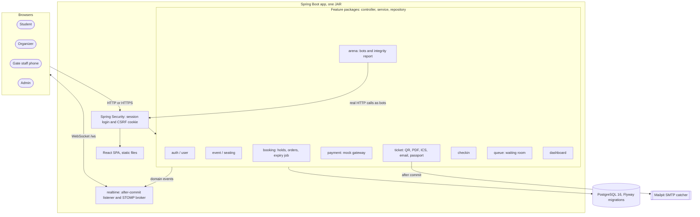
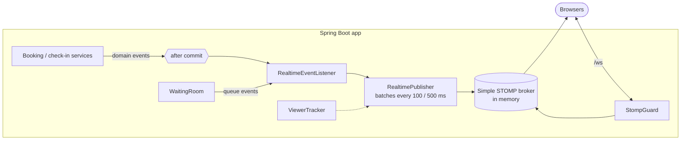

# FestPass architecture

FestPass is one Spring Boot application (a modular monolith) backed by PostgreSQL 16. The React app is built into the same JAR, so one process serves the UI, the REST API and the WebSocket. Every booking guarantee is enforced by PostgreSQL itself, not by Java locks or in-memory state.

## Components



- **One package per feature** under `com.festpass`, each split into controller, service and repository. Controllers return Java `record` DTOs, never JPA entities. Entities refer to each other by id (`Long eventId`), not JPA relations, so every query is explicit.
- **Schema** changes only through Flyway (`V1` to `V4`); Hibernate only validates.
- **Time** always comes from an injected `Clock`, so tests freeze and move it (holds expire, sales open, admission tokens run out) without sleeping.
- **Errors** are thrown as `ApiException(ErrorCode)` and become a `ProblemDetail` with a stable `code`, so the frontend shows the right message without parsing text. Unexpected exceptions become a generic `500 INTERNAL_ERROR`; stack traces never reach the client.
- **Side effects after commit.** WebSocket messages and emails go out only after the database commits, so nobody is told about a hold or a ticket that was rolled back.

## Booking sequence

The path from tapping seats to a ticket. The important statements are conditional `UPDATE`s whose row count says whether we won.

```mermaid
sequenceDiagram
    autonumber
    actor S as Student
    participant API as Booking API
    participant DB as PostgreSQL
    participant RT as Realtime (after commit)
    participant M as Mail (async)

    S->>API: POST /api/events/{id}/holds {seatIds}
    API->>API: rate limit; flash drop: check admission token
    API->>DB: pg_advisory_xact_lock(user, event)
    API->>DB: check per-user ticket limit
    API->>DB: INSERT hold (expires after the event's hold minutes)
    API->>DB: UPDATE seats SET HELD WHERE id IN (...) AND (AVAILABLE OR expired HELD)
    alt rows updated = seats asked for
        API->>DB: COMMIT
        DB-->>RT: committed
        RT-->>S: /topic/events/{id}/seats HELD (to everyone watching)
        API-->>S: 201 hold + expiresAt
    else fewer rows
        API->>DB: ROLLBACK
        API-->>S: 409 SEAT_UNAVAILABLE + unavailableSeatIds
    end

    S->>API: POST /api/orders {holdId} + Idempotency-Key
    API->>DB: same key? return that order. Else INSERT order (UNIQUE hold_id, UNIQUE key)
    API-->>S: 201 order (PENDING)

    S->>API: POST /api/payments/{orderId}/confirm + Idempotency-Key
    API->>DB: SELECT order FOR UPDATE; same key? replay the stored result
    API->>DB: UPDATE holds SET CONVERTED WHERE ACTIVE AND expires_at > now
    API->>DB: UPDATE seats SET BOOKED WHERE hold_id = ? AND HELD RETURNING id
    API->>DB: INSERT tickets (UNIQUE seat_id), order PAID, payment attempt (UNIQUE key)
    API->>DB: COMMIT
    DB-->>RT: committed
    RT-->>S: seats BOOKED, stats, hold CONVERTED
    DB-->>M: confirmation email with QR codes
    API-->>S: 200 SUCCESS + tickets
```

General admission is the same, except the seat update becomes `UPDATE ticket_tiers SET reserved = reserved + n WHERE id = ? AND reserved + n <= capacity`.

## The guarantees and how each is kept

| Guarantee | How it is enforced | Proven by |
|---|---|---|
| **A seat can never be sold twice.** | Holding is one conditional `UPDATE seats ... WHERE status = 'AVAILABLE' OR (HELD and expired)`. PostgreSQL row locks make concurrent updates of the same row wait and then re-check the `WHERE`, so exactly one hold wins each seat. If a hold gets fewer rows than it asked for, its whole transaction rolls back. As a last line of defence, `tickets` has a unique index on `seat_id`. | `ConcurrencyIntegrationTest` (threads released together by a `CountDownLatch`, exactly one winner per seat); Stress Arena `RUSH_SAME_SEATS` (500 bots, 50 seats, `seatsWithSeveralTickets = 0`) |
| **A general-admission tier never sells more than its capacity.** | `UPDATE ticket_tiers SET reserved = reserved + :n WHERE ... AND reserved + :n <= capacity` is atomic, backed by a `CHECK (reserved <= capacity)` constraint. Expired or released holds give their tickets back with the opposite update. | `ConcurrencyIntegrationTest`; Stress Arena `GA_RUSH` (1,000 bots, capacity 100, exactly 100 allocated) |
| **A ticket can be checked in only once.** | `UPDATE tickets SET checked_in_at = now WHERE id = ? AND event_id = ? AND checked_in_at IS NULL`. If two gates scan the same QR at once, one updates 1 row (`VALID`) and the other 0 rows (`ALREADY_USED`, with the first scan's time and gate). QR codes are HMAC-signed, so a forged code is rejected before the database is touched. | `CheckinIntegrationTest` (twenty gates scanning the same ticket at once let it in once) |
| **Retrying with the same idempotency key never creates a second order or ticket set.** | `orders.idempotency_key` and `payment_attempts.idempotency_key` are `UNIQUE`, and `orders.hold_id` is `UNIQUE` (one order per hold). A retry finds the stored order or payment result and returns it. Payment locks the order row (`FOR UPDATE`), so two concurrent confirmations run one after the other and the second replays the first. | `OrderPaymentIntegrationTest` (same keys twice give one order and one ticket set; a key cannot be reused for something else), `ConcurrencyIntegrationTest` (parallel payments with different keys still create one ticket set) |
| **An expired hold never turns into a ticket.** | Payment converts the hold with `UPDATE holds SET status = 'CONVERTED' WHERE status = 'ACTIVE' AND expires_at > now`. An expired hold updates 0 rows, the order fails and nothing is booked, whether or not the expiry job has run yet. Seats also check `hold_expires_at`, so an expired hold's seats can be taken by someone else at once. | `HoldExpiryIntegrationTest` (moves the `MutableClock` past the hold's end, then pays) |

Why not Java locks or `synchronized`? They work only inside one JVM and are easy to get wrong. The database has to be the source of truth anyway, and a single conditional statement is both the check and the write, so there is no gap between them for another request to slip into. The per-user advisory lock (`pg_advisory_xact_lock(userId, eventId)`) only makes the per-user ticket limit exact when one person sends many requests at once; it never blocks other users.

## Stress Arena (Phase 6)

```mermaid
flowchart LR
    admin([Admin]) -- POST /api/admin/arena/runs --> svc[ArenaService]
    svc --> runner[ArenaRunner, virtual thread]
    runner -- 1. copy event --> sandbox[(Sandbox event, is_sandbox)]
    runner -- 2. create bots --> bots[(Bot users, is_bot)]
    runner -- 3. log in --> api[Own HTTP API on 127.0.0.1]
    runner -- 4. CountDownLatch releases all bots --> api
    api --> sandbox
    runner -- 5. integrity SQL --> sandbox
    runner -- progress every 250 ms --> topic[/topic/arena/runId]
    topic --> admin
```

- The bots go through the **real HTTP stack**: Tomcat, Spring Security (login, CSRF cookie), the rate limiter, controllers, services and PostgreSQL. Each bot is a virtual thread with its own cookie jar, sharing one JDK `HttpClient`. A `CountDownLatch` releases them all at the same instant.
- The arena never touches real data. It copies the chosen event (tiers and seats) into a sandbox event that public lists, search, the gate and the user list all hide. **Reset arena** deletes sandbox events, bots and runs.
- After the race, five SQL checks look for anything that would break a guarantee: seats with several tickets, tiers over capacity (reserved or tickets), paid orders without tickets, and booked seats without a ticket. The **0 oversold** badge appears only if all five are zero.
- Bot passwords are hashed with BCrypt cost 4 (instead of 10) so 2,000 bots can be created and logged in within seconds. Real accounts are not affected.
- Tomcat's `accept-count` is raised to 1,000 so a burst of simultaneous connections queues instead of being refused.

## Real-time layer (Phase 3)



- **Changes are announced only after the database commits.** Services publish Spring application events (`SeatsChanged`, `AvailabilityChanged`, `HoldEnded`, `CheckinRecorded`) inside their transaction. `RealtimeEventListener` receives them with `@TransactionalEventListener`, which runs only after a successful commit, so a rolled-back hold is never shown to anyone.
- **Batching.** `RealtimePublisher` collects seat changes per event and sends them at most every 100 ms; a seat that changed twice in that window is sent once, with its latest status. Stats and queue counters go out at most every 500 ms, and only for events someone is watching.
- **Security.** `StompGuard` rejects every client `SEND` and only allows subscriptions to known destinations (some by role). The handshake is an ordinary HTTP request through Spring Security, so the session cookie identifies the user.
- **Viewers.** `ViewerTracker` counts WebSocket connections subscribed to an event's topics, using Spring's subscribe, unsubscribe and disconnect events. Heartbeats every 10 s detect clients that vanished without closing the socket.

## Flash-drop waiting room (Phase 3)

`WaitingRoom` keeps one queue per flash-drop event. Everyone who joins gets the next number, and `QueueAdmissionJob` admits the lowest numbers in batches once the sale opens. An admitted user gets a signed admission token (`userId.eventId.expiry.HMAC`). The hold endpoint checks it without any server state, so tokens stay valid across a restart.

## Single-instance limitations

FestPass is designed to run as **one app instance** (PLAN.md section 11 rules out horizontal scaling). Three things live in that instance's memory, so they would not work correctly with two or more instances behind a load balancer:

| In memory | What breaks with several instances | What a multi-instance version would use |
|---|---|---|
| Waiting-room queues (`WaitingRoom`) | Each instance would have its own queue and positions, and a restart empties the queue | A shared store, e.g. a PostgreSQL table or Redis sorted set |
| STOMP broker (Spring simple broker) | A browser on instance A would not see updates published on instance B | A full broker relay (RabbitMQ or ActiveMQ with STOMP) |
| Hold rate-limit buckets (`HoldRateLimiter`) | Each instance would allow the full rate | A distributed Bucket4j backend (e.g. its PostgreSQL or Redis integration) |

None of these affect the booking guarantees: seats, GA capacity, idempotency and check-in are enforced by PostgreSQL, which all instances would share.

## Security checklist (Phase 7)

| Item | How | Checked by |
|---|---|---|
| Passwords hashed | BCrypt (cost 10) through Spring Security's `PasswordEncoder`; only the hash is stored (`users.password_hash`). Arena bots use cost 4, and only bots. | `SecurityChecklistIntegrationTest.passwordsAreStoredAsBcryptHashes` |
| CSRF protection on | Spring Security's cookie CSRF: the SPA reads the `XSRF-TOKEN` cookie and sends `X-XSRF-TOKEN` on every write; the token rotates at login. Session cookie is `HttpOnly`, `SameSite=Lax`. | `CsrfCookieFlowIntegrationTest` (real cookie flow) |
| Authorisation on every organizer, gate and admin endpoint | URL rules in `SecurityConfig` (`/api/organizer/**` organizer or admin, `/api/checkin/**` gate staff or admin, `/api/admin/**` admin), plus checks in the services: organizers can only touch their own events (`EventService` ownership check, `403` otherwise), gate staff only scan at events they are assigned to. STOMP subscriptions are limited by role in `StompGuard`. | `RoleAccessIntegrationTest` (including `organizerCannotTouchAnotherOrganizersEvent`), `CheckinIntegrationTest.gateStaffCanOnlyScanTheirOwnEvents`, arena admin-only test |
| QR secret and DB credentials from environment variables | `QR_SECRET`, `DB_URL`, `DB_USERNAME`, `DB_PASSWORD`, `MAIL_HOST`, `MAIL_PORT` (see README). The defaults are for local development only; `docker-compose.yml` passes `QR_SECRET` through from the host. | Configuration review |
| No stack traces in API responses | `server.error.include-stacktrace: never` and `include-message: never`; `GlobalExceptionHandler` turns every exception into a `ProblemDetail` with a stable `code`, and unexpected ones into a generic `500 INTERNAL_ERROR` (details only in the server log). | `SecurityChecklistIntegrationTest` (malformed JSON, unexpected exception) |
| Abuse limits | Per-user hold rate limit (5/s, 30/min), per-user ticket limit per event, signed admission tokens for flash drops, HMAC-signed QR codes. | `HoldIntegrationTest`, `ConcurrencyIntegrationTest`, `CheckinIntegrationTest` |

Known limits for a real deployment (out of scope for this project): run behind HTTPS (the `https` profile uses a self-signed certificate for local phone testing only), set a strong `QR_SECRET`, and never enable the `dev` or `demo` profiles, whose sample accounts share a known password.
